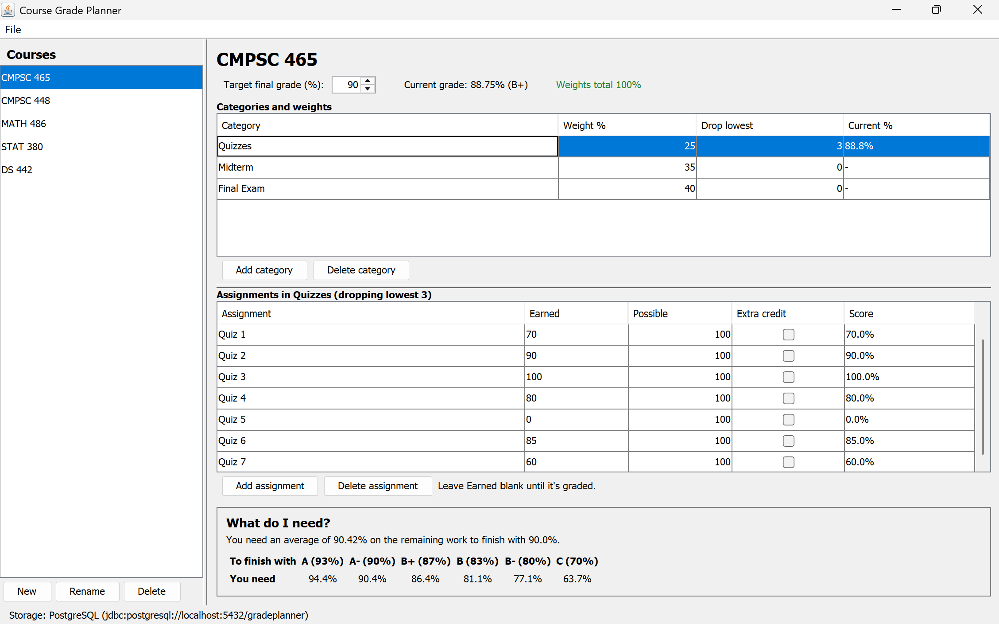

# Course Grade Planner

A Java desktop app that tracks weighted course grades and shows the score you need on the remaining work to reach a target grade.



## What it does

- Add courses, grade categories with weights, and assignments
- Supports dropping the lowest scores in a category and extra credit
- Shows your current grade and the score you need on the remaining work to hit a target
- Saves data in a PostgreSQL database, or keeps it in memory if the database is not running

## How to run it

You need JDK 17 or newer, Maven, and Docker Desktop.

1. Start the database (skip this to run in memory only):

```
   docker compose up -d
```

2. Start the app:

```
   mvn compile exec:java
```

3. When you are done, stop the database:

```
   docker compose down
```

To run the tests:

```
mvn test
```